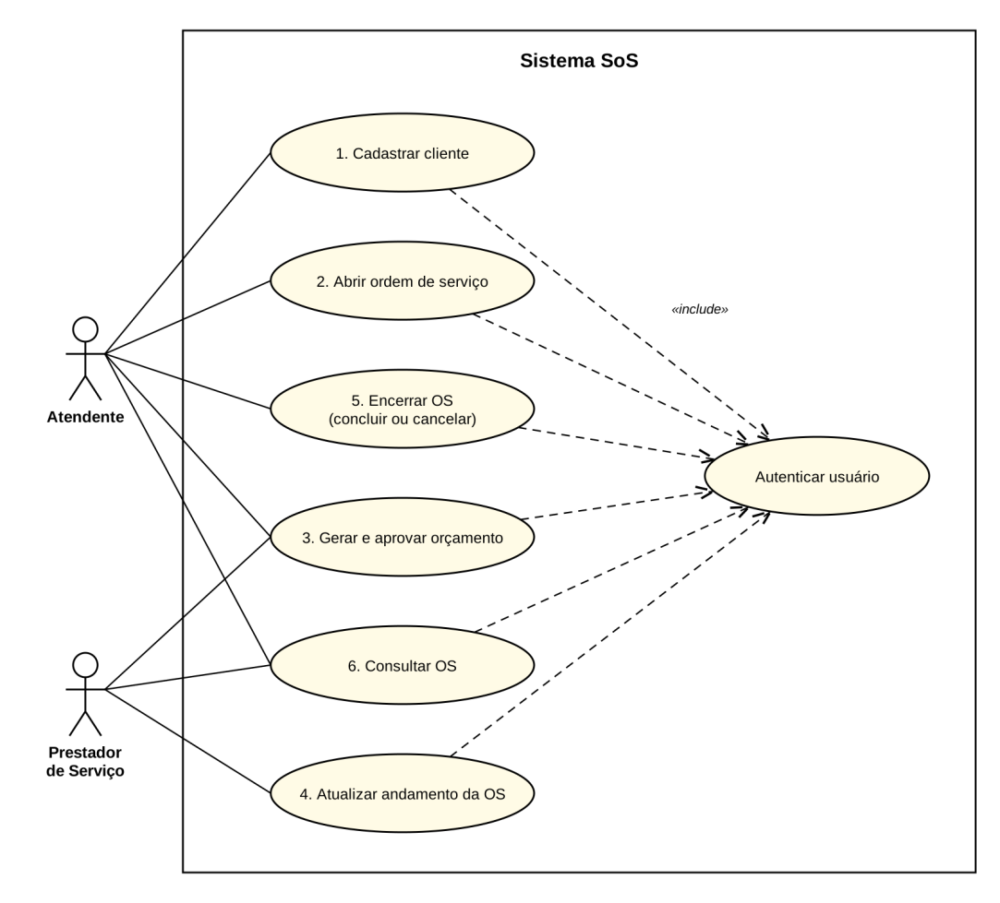
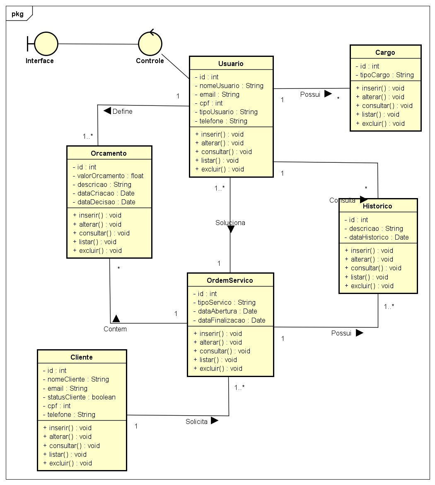

**ESPECIFICAÇÃO DE REQUISITOS DE SOFTWARE (SRS)**

Segundo a norma IEEE 830 / ISO/IEC/IEEE 29148

**Projeto: Sistema de Ordem de Serviço (SoS)**

Versão 1.0 · novembro de 2026

# 1 Introdução

## 1.1 Propósito

Este documento especifica os requisitos do módulo inicial do Sistema de
Ordem de Serviço (SoS). Ele serve de referência para as equipes de
desenvolvimento (back-end e front-end) e para a validação do que será
construído.

## 1.2 Escopo

O SoS é um sistema web genérico para gerenciar ordens de serviço. O
módulo inicial cobre: cadastro de clientes, abertura de OS, geração e
aprovação de orçamento, acompanhamento do andamento, encerramento
(conclusão ou cancelamento) e consulta de OS.

Ficam fora do escopo: controle de estoque, emissão de nota fiscal,
agendamento, módulo financeiro completo e integração com sistemas
externos.

## 1.3 Definições, siglas e abreviações

| **Termo**                | **Definição**                                                                                                  |
|--------------------------|----------------------------------------------------------------------------------------------------------------|
| **SoS**                  | Sistema de Ordem de Serviço.                                                                                   |
| **OS**                   | Ordem de Serviço: registro de um serviço solicitado por um cliente.                                            |
| **SRS**                  | Software Requirements Specification (Especificação de Requisitos de Software).                                 |
| **UML**                  | Unified Modeling Language, linguagem de modelagem usada nos diagramas.                                         |
| **RF / RNF**             | Requisito Funcional / Requisito Não Funcional.                                                                 |
| **Cliente**              | Pessoa ou empresa que solicita o serviço. Não acessa o sistema.                                                |
| **Atendente**            | Usuário que cadastra clientes, abre e encerra OS e registra a decisão sobre o orçamento.                       |
| **Prestador de Serviço** | Usuário que executa o serviço, elabora o orçamento e atualiza o andamento (chamado de “Prestador” nos fluxos). |
| **Papel**                | Função exercida no sistema; uma pessoa pode acumular mais de um papel.                                         |
| **Orçamento**            | Proposta de valor e prazo elaborada para uma OS; pode estar Pendente, Aprovado ou Recusado.                    |
| **Status**               | Situação da OS: Aberta, Aguardando aprovação, Em execução, Pronta, Encerrada ou Cancelada.                     |

# 2 Descrição Geral

## 2.1 Perspectiva do produto

O SoS é uma aplicação web independente, com banco de dados próprio, que
não depende de outros sistemas para funcionar.

## 2.2 Classes de usuários

O sistema possui dois perfis de usuário, descritos no Quadro 1.

**Quadro 1 – Classes de usuários do sistema**

| **Usuário**              | **Responsabilidades**                                                                 | **Características**                                                                  |
|--------------------------|---------------------------------------------------------------------------------------|--------------------------------------------------------------------------------------|
| **Atendente**            | Cadastra clientes, abre OS, registra a aprovação ou recusa do orçamento e encerra OS. | Atendimento direto ao cliente; conhecimento básico de informática.                   |
| **Prestador de Serviço** | Elabora o orçamento, executa o serviço e registra o andamento da OS.                  | Pode ser autônomo ou integrante de uma equipe; usa o sistema em campo ou na oficina. |

Os papéis são acumuláveis: uma mesma pessoa pode ser Atendente e
Prestador de Serviço, como no caso de um prestador autônomo.

## 2.3 Restrições

• O sistema é web e funciona nos navegadores atuais, em telas de celular
e de computador.

• O acesso exige autenticação e é controlado por papel.

• O tratamento de dados pessoais segue a Lei Geral de Proteção de Dados
(LGPD).

• Toda mudança de status registra data, hora e usuário responsável.

• O uso depende de conexão com a internet.

# 3 Modelagem UML

## 3.1 Diagrama de casos de uso

O modelo possui 2 atores e 6 casos de uso. Todos os casos de uso incluem
(\<\<include\>\>) o caso “Autenticar usuário”. A Figura 1 apresenta o
diagrama e o Quadro 2 relaciona cada ator aos casos de uso.

**Figura 1 – Diagrama de casos de uso do SoS**

*Fonte: os autores (2026)*

Quadro 2 – Associação entre atores e casos de uso

| **Nº** | **Caso de uso**                    | **Ator(es)**                    | **Requisito** |
|--------|------------------------------------|---------------------------------|---------------|
| UC1    | Cadastrar cliente                  | Atendente                       | RF001         |
| UC2    | Abrir ordem de serviço             | Atendente                       | RF002         |
| UC3    | Gerar e aprovar orçamento          | Prestador de Serviço, Atendente | RF003         |
| UC4    | Atualizar andamento da OS          | Prestador de Serviço            | RF004         |
| UC5    | Encerrar OS (concluir ou cancelar) | Atendente                       | RF005         |
| UC6    | Consultar OS                       | Atendente, Prestador de Serviço | RF006         |

### 3.1.1 Descrição dos atores

**Atendente:** responsável pelo relacionamento com o cliente. Cadastra
clientes, abre as OS, registra se o orçamento foi aprovado ou recusado e
encerra a OS.

**Prestador de Serviço:** responsável pela execução. Elabora o
orçamento, atualiza o andamento e marca a OS como pronta.

## 3.2 Diagrama de classes

O diagrama de classes representa as entidades do sistema: Usuario,
Cargo, Cliente, OrdemServico, Orcamento e Historico, e as relações entre
elas.

**Figura 2 – Diagrama de classes do SoS**

*Fonte: os autores (2026)*

# 4 Requisitos Específicos

## 4.1 Requisitos funcionais

O Quadro 3 lista os requisitos funcionais; cada um corresponde a um caso
de uso.

**Quadro 3 – Requisitos funcionais**

| **ID**    | **Requisito**                      | **Caso de uso** | **Ator(es)**          |
|-----------|------------------------------------|-----------------|-----------------------|
| **RF001** | Cadastrar cliente                  | UC1             | Atendente             |
| **RF002** | Abrir ordem de serviço             | UC2             | Atendente             |
| **RF003** | Gerar e aprovar orçamento          | UC3             | Prestador / Atendente |
| **RF004** | Atualizar andamento da OS          | UC4             | Prestador             |
| **RF005** | Encerrar OS (concluir ou cancelar) | UC5             | Atendente             |
| **RF006** | Consultar OS                       | UC6             | Atendente / Prestador |

### 4.1.1 RF001 – Cadastrar cliente

<table>
<colgroup>
<col style="width: 21%" />
<col style="width: 78%" />
</colgroup>
<tbody>
<tr class="odd">
<td><strong>Descrição</strong></td>
<td>O sistema deve permitir cadastrar, editar e consultar os clientes
que solicitam serviços.</td>
</tr>
<tr class="even">
<td><strong>Atores</strong></td>
<td>Atendente</td>
</tr>
<tr class="odd">
<td><strong>Pré-condições</strong></td>
<td>• Usuário autenticado como Atendente.</td>
</tr>
<tr class="even">
<td><strong>Fluxo principal</strong></td>
<td>
1. O Atendente seleciona “Novo cliente”.

2. Informa nome, CPF ou CNPJ, telefone e e-mail.

3. O sistema valida os campos obrigatórios.

4. O Atendente confirma o cadastro.

5. O sistema grava o cliente e exibe a confirmação.
</td>
</tr>
<tr class="odd">
<td><strong>Fluxos alternativos</strong></td>
<td>
• Cliente já cadastrado: no passo 3, o sistema detecta CPF ou
CNPJ repetido, informa o Atendente, exibe o cadastro existente e não
cria novo registro.

• Campo obrigatório ausente ou inválido: o sistema destaca os campos
a corrigir e retorna ao passo 2.

• Editar ou consultar: o Atendente busca o cliente por nome ou
CPF/CNPJ, visualiza os dados, altera o que for preciso e confirma; o
fluxo segue do passo 3.
</td>
</tr>
<tr class="even">
<td><strong>Pós-condições</strong></td>
<td>• Cliente registrado e disponível para a abertura de OS.</td>
</tr>
<tr class="odd">
<td><strong>Critérios de aceite</strong></td>
<td>
• Não permitir dois clientes com o mesmo CPF ou CNPJ.

• Nome, CPF ou CNPJ e telefone são obrigatórios; o e-mail é opcional,
mas, se informado, deve ter formato válido.

• O CPF ou CNPJ é validado pelos dígitos verificadores.

• O cliente cadastrado aparece na pesquisa de clientes assim que o
cadastro é confirmado.
</td>
</tr>
</tbody>
</table>

### 4.1.2 RF002 – Abrir ordem de serviço

<table>
<colgroup>
<col style="width: 21%" />
<col style="width: 78%" />
</colgroup>
<tbody>
<tr class="odd">
<td><strong>Descrição</strong></td>
<td>O sistema deve permitir registrar a solicitação de serviço de um
cliente cadastrado, gerando uma OS com número único e status
“Aberta”.</td>
</tr>
<tr class="even">
<td><strong>Atores</strong></td>
<td>Atendente</td>
</tr>
<tr class="odd">
<td><strong>Pré-condições</strong></td>
<td>
• Usuário autenticado como Atendente.

• Cliente cadastrado [RF001].
</td>
</tr>
<tr class="even">
<td><strong>Fluxo principal</strong></td>
<td>
1. O Atendente seleciona “Nova ordem de serviço”.

2. Pesquisa e escolhe o cliente.

3. Informa a descrição do serviço solicitado e seleciona o prestador
responsável.

4. O sistema exibe o resumo (cliente, serviço, prestador e data de
abertura).

5. O Atendente confirma a abertura.

6. O sistema gera o número único, define o status “Aberta” e registra
a data de abertura.

7. O sistema exibe a confirmação com o número da OS.
</td>
</tr>
<tr class="odd">
<td><strong>Fluxos alternativos</strong></td>
<td>
• Cliente não encontrado: no passo 2, o sistema oferece o
cadastro [RF001]; concluído o cadastro, retorna à busca.

• Descrição do serviço não informada: no passo 5, o sistema impede a
abertura, indica o campo e retorna ao passo 3.

• Prestador não selecionado: o sistema solicita a escolha antes de
abrir a OS.
</td>
</tr>
<tr class="even">
<td><strong>Pós-condições</strong></td>
<td>• OS criada com status “Aberta”, vinculada ao cliente e ao
prestador, pronta para receber orçamento.</td>
</tr>
<tr class="odd">
<td><strong>Critérios de aceite</strong></td>
<td>
• Não abrir OS sem a descrição do serviço.

• Número da OS único; data de abertura automática e sem edição.

• Só é possível abrir OS para cliente cadastrado.
</td>
</tr>
</tbody>
</table>

### 4.1.3 RF003 – Gerar e aprovar orçamento

<table>
<colgroup>
<col style="width: 21%" />
<col style="width: 78%" />
</colgroup>
<tbody>
<tr class="odd">
<td><strong>Descrição</strong></td>
<td>O sistema deve permitir que o Prestador de Serviço elabore o
orçamento de uma OS e que o Atendente registre a aprovação ou a recusa
do cliente.</td>
</tr>
<tr class="even">
<td><strong>Atores</strong></td>
<td>Prestador de Serviço, Atendente</td>
</tr>
<tr class="odd">
<td><strong>Pré-condições</strong></td>
<td>
• Usuário autenticado.

• OS com status “Aberta”.
</td>
</tr>
<tr class="even">
<td><strong>Fluxo principal</strong></td>
<td>
1. O Prestador abre a OS e seleciona “Gerar orçamento”.

2. Informa a descrição do serviço, o valor e o prazo.

3. O sistema salva o orçamento como “Pendente” e altera a OS para
“Aguardando aprovação”.

4. O Atendente apresenta o orçamento ao cliente.

5. O Atendente registra a decisão do cliente: “Aprovado”.

6. O sistema atualiza o orçamento para “Aprovado” e a OS para “Em
execução”.
</td>
</tr>
<tr class="odd">
<td><strong>Fluxos alternativos</strong></td>
<td>
• Cliente recusa o orçamento: no passo 5, o Atendente registra
“Recusado”; o sistema atualiza o orçamento para “Recusado” e devolve a
OS ao status “Aberta”.

• Valor ou prazo inválidos: no passo 2, o sistema recusa os dados,
indica o campo e retorna ao preenchimento.
</td>
</tr>
<tr class="even">
<td><strong>Pós-condições</strong></td>
<td>
• Orçamento aprovado: a OS passa para “Em execução”.

• Orçamento recusado: o orçamento fica registrado como “Recusado” e a
OS volta a “Aberta”, podendo receber um novo orçamento do Prestador ou
ser cancelada pelo Atendente [RF005].
</td>
</tr>
<tr class="odd">
<td><strong>Critérios de aceite</strong></td>
<td>
• O valor do orçamento deve ser maior que zero.

• Somente OS com status “Aberta” recebe orçamento.

• A decisão do cliente registra data e usuário.

• O orçamento recusado permanece no histórico da OS.
</td>
</tr>
</tbody>
</table>

### 4.1.4 RF004 – Atualizar andamento da OS

<table>
<colgroup>
<col style="width: 21%" />
<col style="width: 78%" />
</colgroup>
<tbody>
<tr class="odd">
<td><strong>Descrição</strong></td>
<td>O sistema deve permitir que o Prestador de Serviço registre o
andamento de uma OS sob sua responsabilidade e, quando o serviço estiver
concluído, altere o status da OS para “Pronta”.</td>
</tr>
<tr class="even">
<td><strong>Atores</strong></td>
<td>Prestador de Serviço</td>
</tr>
<tr class="odd">
<td><strong>Pré-condições</strong></td>
<td>
• Usuário autenticado como Prestador de Serviço.

• OS atribuída ao Prestador e com status “Em execução”
[RF003].
</td>
</tr>
<tr class="even">
<td><strong>Fluxo principal</strong></td>
<td>
1. O Prestador acessa a lista de OS sob sua responsabilidade.

2. Seleciona a OS que deseja atualizar.

3. O sistema exibe os dados da OS e o histórico de andamento.

4. O Prestador informa uma observação sobre o progresso do
serviço.

5. Se o serviço estiver concluído, o Prestador marca a OS como
“Pronta”.

6. O Prestador confirma a atualização.

7. O sistema registra a observação no histórico, com data, hora e
usuário, e atualiza o status, se alterado.

8. O sistema exibe a confirmação da atualização.
</td>
</tr>
<tr class="odd">
<td><strong>Fluxos alternativos</strong></td>
<td>
• Serviço ainda em andamento: no passo 5, o Prestador não altera
o status; o sistema registra apenas a observação e a OS permanece “Em
execução”.

• OS de outro prestador: no passo 2, o sistema impede a atualização e
informa que a OS está sob responsabilidade de outro prestador.

• OS fora do status “Em execução”: no passo 2, o sistema informa que
a OS não aceita atualização de andamento e retorna ao passo 1.

• Observação não informada: no passo 6, o sistema destaca o campo e
retorna ao passo 4.

• Operação não confirmada: no passo 6, o sistema descarta a alteração
e mantém o andamento anterior.
</td>
</tr>
<tr class="even">
<td><strong>Pós-condições</strong></td>
<td>
• Observação registrada no histórico da OS, com data, hora e
responsável.

• Se marcada como “Pronta”, a OS passa a aguardar o encerramento pelo
Atendente [RF005]; caso contrário, permanece “Em execução”.
</td>
</tr>
<tr class="odd">
<td><strong>Critérios de aceite</strong></td>
<td>
• Somente o Prestador responsável pela OS pode atualizar o seu
andamento.

• Somente OS com status “Em execução” aceita atualização de
andamento.

• Não é possível salvar uma atualização sem observação.

• Data, hora e usuário de cada registro são gravados automaticamente
e não podem ser editados.

• Os registros de andamento já gravados não podem ser alterados nem
excluídos.

• A única mudança de status permitida neste requisito é de “Em
execução” para “Pronta”.
</td>
</tr>
</tbody>
</table>

### 4.1.5 RF005 – Encerrar OS (concluir ou cancelar)

<table>
<colgroup>
<col style="width: 21%" />
<col style="width: 78%" />
</colgroup>
<tbody>
<tr class="odd">
<td><strong>Descrição</strong></td>
<td>O sistema deve permitir que o Atendente encerre uma OS, registrando
a sua conclusão (status “Encerrada”) ou o seu cancelamento (status
“Cancelada”).</td>
</tr>
<tr class="even">
<td><strong>Atores</strong></td>
<td>Atendente</td>
</tr>
<tr class="odd">
<td><strong>Pré-condições</strong></td>
<td>
• Usuário autenticado como Atendente.

• OS com status diferente de “Encerrada” e “Cancelada”.

• Para concluir, a OS deve estar com status “Pronta”
[RF004].
</td>
</tr>
<tr class="even">
<td><strong>Fluxo principal</strong></td>
<td>
1. O Atendente acessa a lista de OS.

2. Seleciona a OS que deseja encerrar.

3. O sistema exibe os dados e o status atual da OS.

4. O Atendente escolhe “Concluir” ou “Cancelar”.

5. Informa uma observação sobre o encerramento.

6. O sistema solicita a confirmação da operação.

7. O Atendente confirma.

8. O sistema altera o status para “Encerrada” (conclusão) ou
“Cancelada” (cancelamento) e registra data, hora e usuário.

9. O sistema exibe a confirmação do encerramento.
</td>
</tr>
<tr class="odd">
<td><strong>Fluxos alternativos</strong></td>
<td>
• OS já encerrada ou cancelada: no passo 2, o sistema impede a
operação e informa que a OS já foi finalizada.

• Conclusão de OS que não está “Pronta”: no passo 4, o sistema não
permite concluir, informa que o serviço ainda não foi finalizado pelo
Prestador e oferece cancelar a OS ou voltar à lista.

• Cancelamento sem justificativa: no passo 5, o sistema exige a
justificativa antes de prosseguir.

• Operação não confirmada: no passo 7, o sistema mantém o status
anterior da OS.
</td>
</tr>
<tr class="even">
<td><strong>Pós-condições</strong></td>
<td>
• OS com status “Encerrada” ou “Cancelada”.

• Operação registrada no histórico da OS, com data, hora e
responsável.

• A OS não aceita novas atualizações de andamento [RF004] nem novos
orçamentos [RF003].
</td>
</tr>
<tr class="odd">
<td><strong>Critérios de aceite</strong></td>
<td>
• Só é possível concluir uma OS com status “Pronta”.

• O cancelamento é permitido em qualquer status, exceto “Encerrada” e
“Cancelada”, e exige justificativa.

• A mudança de status só ocorre após confirmação explícita do
Atendente.

• Uma OS encerrada ou cancelada não pode ser reaberta nem
alterada.

• Data, hora e usuário do encerramento são gravados
automaticamente.
</td>
</tr>
</tbody>
</table>

### 4.1.6 RF006 – Consultar OS

<table>
<colgroup>
<col style="width: 21%" />
<col style="width: 78%" />
</colgroup>
<tbody>
<tr class="odd">
<td><strong>Descrição</strong></td>
<td>O sistema deve permitir que o Atendente e o Prestador de Serviço
consultem OS, visualizando dados do cliente, serviço, prestador,
orçamentos, status e histórico de andamento.</td>
</tr>
<tr class="even">
<td><strong>Atores</strong></td>
<td>Atendente, Prestador de Serviço</td>
</tr>
<tr class="odd">
<td><strong>Pré-condições</strong></td>
<td>• Usuário autenticado.</td>
</tr>
<tr class="even">
<td><strong>Fluxo principal</strong></td>
<td>
1. O usuário seleciona “Consultar OS”.

2. O sistema exibe a lista de OS disponíveis para o seu papel: todas,
para o Atendente; somente as sob sua responsabilidade, para o
Prestador.

3. O usuário informa o número da OS ou usa os filtros (cliente ou
status).

4. O sistema exibe as OS correspondentes.

5. O usuário seleciona uma OS.

6. O sistema exibe os dados do cliente, a descrição do serviço, o
prestador responsável, os orçamentos, o status e o histórico de
andamento.
</td>
</tr>
<tr class="odd">
<td><strong>Fluxos alternativos</strong></td>
<td>
• Nenhum filtro informado: no passo 3, o sistema mantém a lista
completa de OS disponíveis para o usuário.

• Nenhuma OS encontrada: no passo 4, o sistema informa que não há OS
correspondentes à pesquisa e permite nova busca.

• OS fora do alcance do papel: no passo 5, o sistema impede a
visualização e informa o motivo.
</td>
</tr>
<tr class="even">
<td><strong>Pós-condições</strong></td>
<td>
• Informações da OS exibidas ao usuário.

• Nenhum dado da OS é alterado pela consulta.
</td>
</tr>
<tr class="odd">
<td><strong>Critérios de aceite</strong></td>
<td>
• O Prestador visualiza somente as OS sob sua responsabilidade; o
Atendente visualiza todas.

• É possível pesquisar por número da OS, por cliente (nome ou
CPF/CNPJ) e por status, e combinar cliente e status na mesma
pesquisa.

• O histórico é exibido em ordem cronológica, com data, hora e
usuário de cada registro.

• Os orçamentos recusados também aparecem na consulta [RF003].

• A tela de consulta não oferece edição: é somente leitura.
</td>
</tr>
</tbody>
</table>

## 4.2 Requisitos não funcionais

O Quadro 4 reúne os requisitos não funcionais, que valem para todo o
sistema.

**Quadro 4 – Requisitos não funcionais**

| **ID**     | **Categoria**                  | **Descrição**                                                                                                                                                                                                                              |
|------------|--------------------------------|--------------------------------------------------------------------------------------------------------------------------------------------------------------------------------------------------------------------------------------------|
| **RNF001** | Segurança (autenticação)       | O acesso exige login e senha. As senhas são armazenadas apenas como hash com algoritmo próprio para senhas (bcrypt ou Argon2), nunca em texto puro, e a sessão expira após 30 minutos sem uso.                                             |
| **RNF002** | Segurança (controle de acesso) | Cada papel acessa somente as funções que lhe cabem (seção 3.1, Diagrama de Casos de Uso). Uma chamada direta, por URL ou API, a uma função não permitida para o papel deve ser recusada pelo servidor.                                     |
| **RNF003** | Segurança (comunicação)        | Toda comunicação entre navegador e servidor usa HTTPS (TLS 1.2 ou superior); acessos por HTTP são redirecionados para HTTPS.                                                                                                               |
| **RNF004** | Conformidade (LGPD)            | Os dados pessoais dos clientes (nome, CPF/CNPJ, telefone e e-mail) só são exibidos a usuários autenticados e usados apenas para o atendimento das OS. O sistema permite atender a pedido do titular de consulta e correção dos seus dados. |
| **RNF005** | Rastreabilidade                | Toda mudança de status de OS e toda decisão de orçamento gravam data, hora e usuário. Esses registros não podem ser editados nem excluídos por nenhum papel.                                                                               |
| **RNF006** | Desempenho                     | A consulta de OS por número ou por filtros retorna o resultado em até 2 segundos, com uma base de 10.000 OS e até 20 usuários simultâneos.                                                                                                 |
| **RNF007** | Desempenho                     | As telas principais (lista de OS, abertura de OS e cadastro de cliente) carregam em até 3 segundos em uma conexão de 10 Mbps.                                                                                                              |
| **RNF008** | Confiabilidade (integridade)   | O número da OS é único mesmo quando duas OS são abertas ao mesmo tempo. Cada mudança de status é gravada por inteiro ou não é gravada (transação), sem deixar a OS em estado intermediário.                                                |
| **RNF009** | Confiabilidade (backup)        | O banco de dados tem backup automático diário, mantido por 30 dias, com restauração possível em até 4 horas.                                                                                                                               |
| **RNF010** | Disponibilidade                | O sistema fica disponível em pelo menos 99% do horário comercial (segunda a sábado, das 8h às 18h), medido por mês.                                                                                                                        |
| **RNF011** | Usabilidade                    | Um usuário com conhecimento básico de informática, após demonstração de até 15 minutos, consegue abrir uma OS para um cliente já cadastrado em até 2 minutos, sem consultar manual.                                                        |
| **RNF012** | Usabilidade (mensagens)        | Os campos obrigatórios são identificados na tela, e as mensagens de erro, em português, indicam o campo com problema e como corrigi-lo.                                                                                                    |
| **RNF013** | Compatibilidade                | O sistema funciona, sem instalação, nas duas versões estáveis mais recentes do Chrome, Firefox, Edge e Safari.                                                                                                                             |
| **RNF014** | Responsividade                 | A interface pode ser usada em telas de 360 px a 1920 px de largura sem rolagem horizontal e sem perda de funções.                                                                                                                          |
